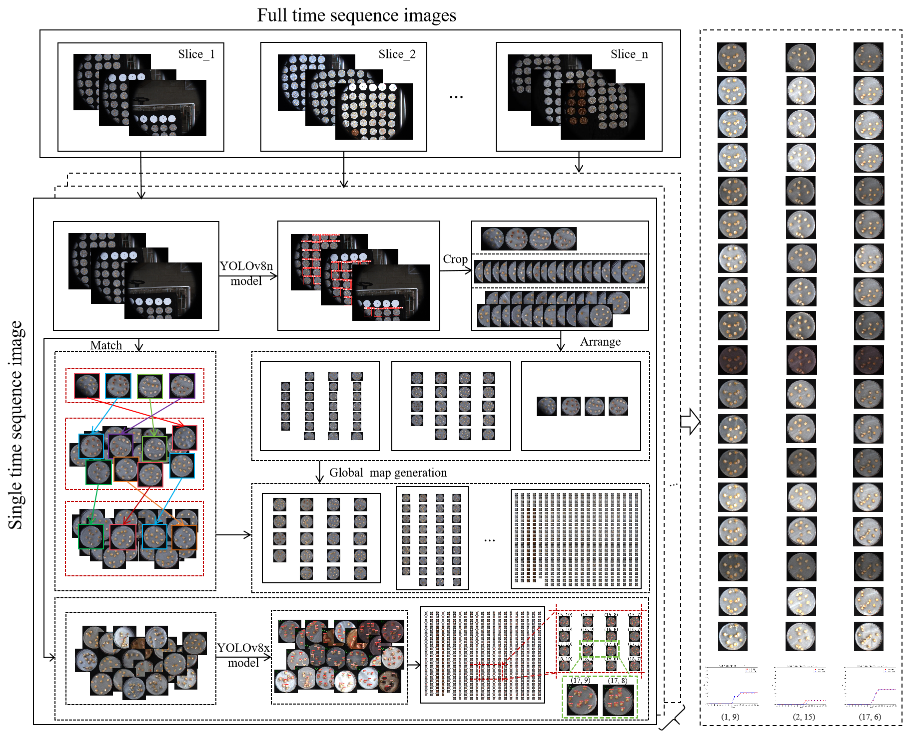
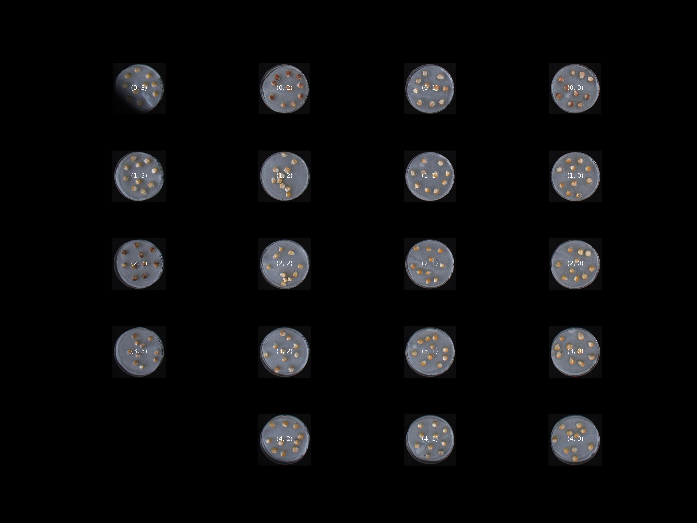
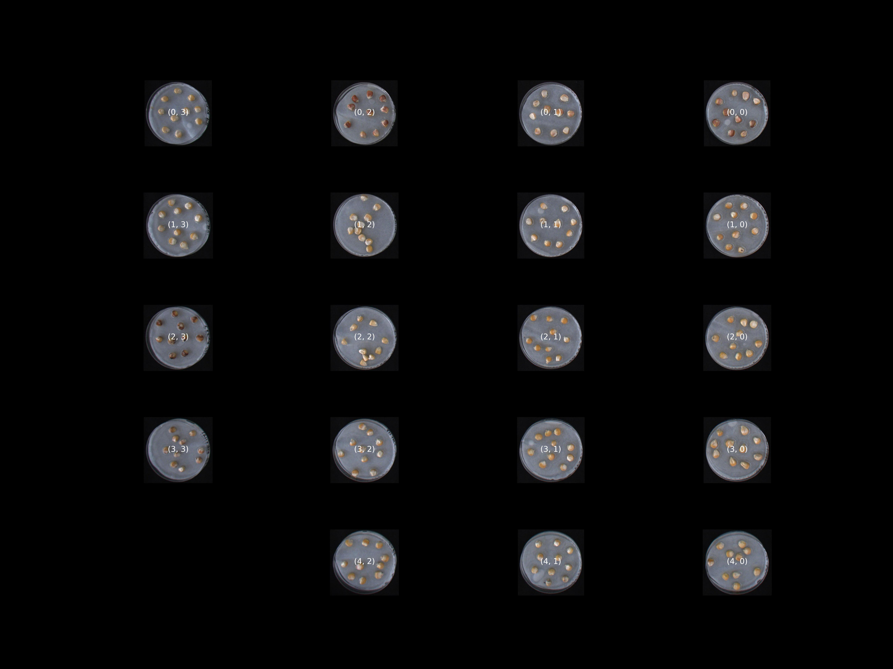

# PIS-SGRDet

**Pseudo-image stitching and deep learning based method for large-scale corn seed germination rate detection**

PIS-SGRDet combines pseudo-image stitching with DSG-Mamba-YOLO to support
large-scale corn seed germination monitoring. The stitching stage associates
culture-dish patches across local images and selects a patch for each global
coordinate. The detection stage identifies seeds and buds in the resulting
patches and supports germination-rate calculation.



## Repository structure

```text
PIS-SGRDet/
├── unit_sort.py                     # Restore local culture-dish arrangement
├── variant_temple_matching.py       # Match patches in adjacent local images
├── iterative_global_map.py          # Build the global coordinate map
├── optimize_patch_for_each_cor.py   # Select a patch for each coordinate
├── images/                          # Method overview and example results
└── DSG-Mamba-YOLO/                  # Improved seed and bud detector
    ├── dsg-mbyolo_train.py
    ├── dsg-mbyolo_val.py
    ├── dsg-mbyolo_predict.py
    ├── dsg-mbyolo_model_info.py
    ├── dsg-mbyolo_germination_rate.py
    ├── dsg-mbyolo_visualize_activation.py
    ├── ultralytics/                 # Local detector implementation and YAMLs
    └── selective_scan/              # CUDA selective-scan extension
```

## Installation

```bash
git clone https://github.com/Wying0337/PIS-SGRDet.git
cd PIS-SGRDet
```

### Pseudo-image stitching

The original stitching environment uses Python 3.8.20 with:

```bash
pip install numpy==1.20.0 opencv-python==4.11.0.86 matplotlib==3.7.5 pillow
```

Some scripts use Matplotlib's `TkAgg` backend and require Tk support and a
graphical session. Configure a suitable backend before running them on a
headless server.

### DSG-Mamba-YOLO

The detector requires a separate environment with compatible PyTorch, CUDA
and selective-scan builds. See the [detector README](DSG-Mamba-YOLO/README.md)
for installation, data preparation, training and inference.

## Pseudo-image stitching workflow

Prepare local images, culture-dish detection results and the corresponding
JSON files before running the pipeline. Set the input and output paths in
each script to match your data. The culture-dish detection inputs used by
this stage are distinct from the seed and bud predictions of DSG-Mamba-YOLO.

Run the following commands from the repository root, in order:

```bash
python unit_sort.py
python variant_temple_matching.py
python iterative_global_map.py
python optimize_patch_for_each_cor.py
```

| Script | Purpose |
| --- | --- |
| `unit_sort.py` | Restore the arrangement of detected culture-dish patches within each local image. |
| `variant_temple_matching.py` | Match patches of the same culture dish between adjacent local images. |
| `iterative_global_map.py` | Combine pairwise correspondences into a global coordinate map. |
| `optimize_patch_for_each_cor.py` | Select a patch from the available views for each coordinate. |

The template-matching implementation uses the computed scores directly;
it does not apply the former fixed `0.5` score cutoff. Detector confidence,
NMS IoU and evaluation IoU thresholds are configured separately.

### Example results

| Before patch selection | After patch selection |
| --- | --- |
|  |  |

## Seed and bud detection

DSG-Mamba-YOLO extends Mamba-YOLO with grouped bottleneck convolution (GBC)
and dynamic spectral gating. The active implementation is
[`mamba_yolo.py`](DSG-Mamba-YOLO/ultralytics/nn/modules/mamba_yolo.py).

The six application scripts use the `dsg-mbyolo_` filename prefix. Internal
module names and class names are retained for import and checkpoint
compatibility. Run detector commands from `DSG-Mamba-YOLO/` so that they use
the included implementation.

See [detector usage](DSG-Mamba-YOLO/README.md) and
[implementation notes](INTEGRATION_NOTES.md).

## Data and checkpoints

This source distribution does not include trained model weights or the full
training and evaluation datasets. Supply your own data and checkpoints and
update the script paths before use. Class IDs are `0: seed` and `1: bud`.
For independent evaluation, provide a separate test split in the dataset YAML.

## Acknowledgments and licenses

The detector builds on [Mamba-YOLO](https://github.com/HZAI-ZJNU/Mamba-YOLO),
[Ultralytics](https://github.com/ultralytics/ultralytics) and the selective-scan
implementation from [VMamba](https://github.com/MzeroMiko/VMamba).

The root [license](license) and the detector's
[AGPL-3.0 license](DSG-Mamba-YOLO/LICENSE) are retained. Refer to the license
and source notices of each component for its applicable terms.
